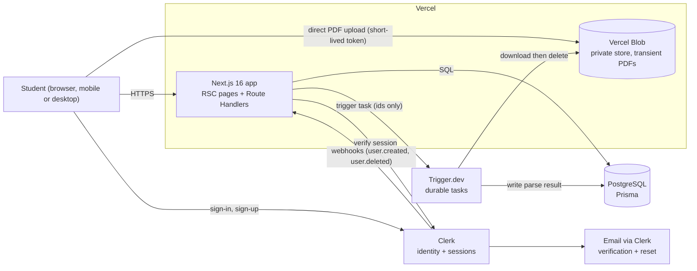
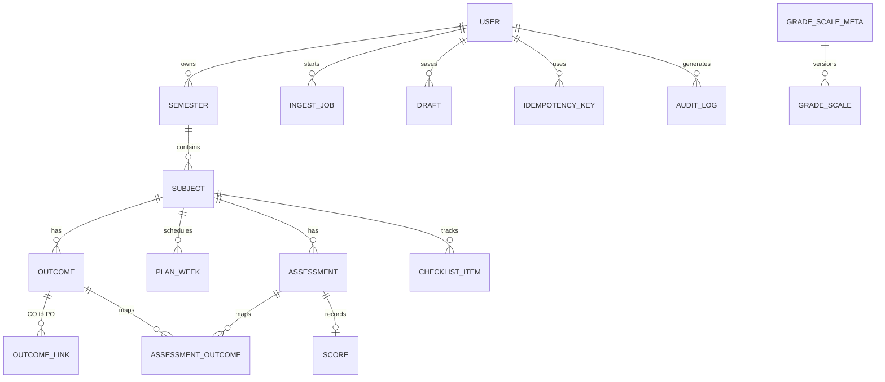
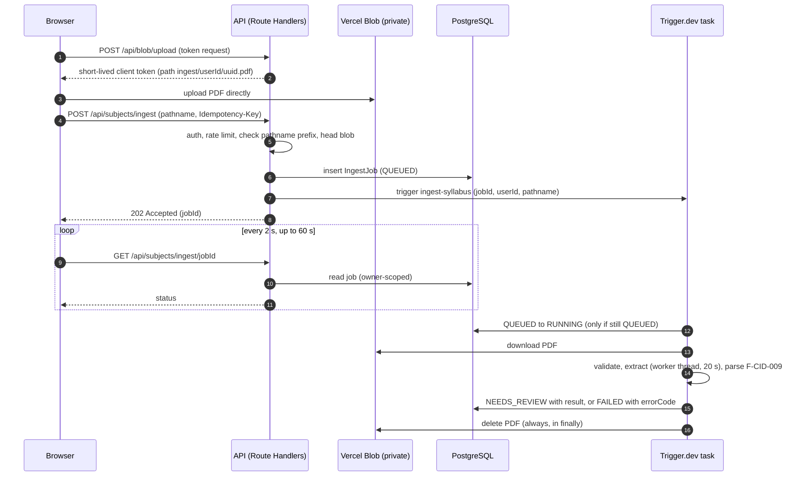
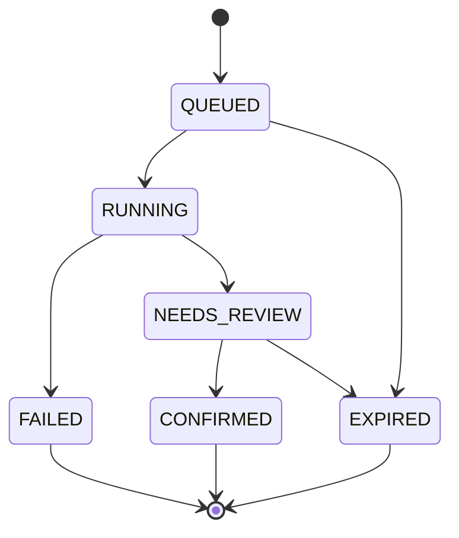

# GOLDENSYNC: SYSTEM ARCHITECTURE

| Field                   | Value                                                                         |
| ----------------------- | ----------------------------------------------------------------------------- |
| Document                | System Architecture Specification                                             |
| Version                 | 2.0 (supersedes the architecture-context draft)                               |
| Date                    | 2026-11-10                                                                    |
| Status                  | **Proposed.** Pending owner decisions in section 2.2                          |
| Audience                | Developers and AI coding agents (Cursor). Read before writing any server code |
| Product source of truth | `GoldenSync-System-Plan-v2.drawio` (flows, limits, behavior)                  |
| UI source of truth      | `DESIGN_RULES.md`, `system-ui-context.md`                                     |
| Related                 | `figma-prototype-system-plan.md`, `system-progress-tracker.md`                |

---

## 0. HOW TO READ THIS DOCUMENT

- Sections 1–2 explain **what changed from the original draft and why**. Read them first.
- Sections 3–16 are the specification. Each states a decision and its enforcement.
- Section 17 lists the **invariants**. Every pull request must keep them true.
- Section 18 records architecture decisions (ADRs). Section 19 lists what is still open or must be verified against vendor docs.
- Code blocks are **illustrative**, not copy-paste final. Verify API names against current vendor docs before use.

---

## 1. EXECUTIVE SUMMARY

**GoldenSync** is a responsive web app where a university student keeps a private tracker of their semesters, subjects, syllabus outcomes and scores, and gets an **estimated** (self-reported) result per subject. A subject is created by uploading a syllabus PDF (CSU form F-CID-009), by manual entry, or both through the same form.

### 1.1 Architecture in one paragraph

A **Next.js 16 (App Router, TypeScript)** monolith deployed on Vercel. **Clerk** owns identity and sessions. **PostgreSQL via Prisma** owns all structured data and is the single source of truth. **Route Handlers** under `app/api` are the only mutation boundary: they validate input, enforce ownership, persist, and enqueue work. **Trigger.dev** runs the only long-running workload (syllabus PDF parsing). **Vercel Blob (private store)** holds uploaded PDFs only for the seconds between upload and parsing, then they are deleted. Grade results are **derived on read** from stored raw scores by pure, heavily tested domain code.

### 1.2 Quality attributes (ranked)

| #   | Attribute                | Why it ranks here                                                 | Primary mechanisms                                                                 |
| --- | ------------------------ | ----------------------------------------------------------------- | ---------------------------------------------------------------------------------- |
| 1   | **Confidentiality**      | Academic data and syllabus content are private to one account     | Ownership-scoped queries, 404 on foreign ids, private Blob, audit log, no sharing  |
| 2   | **Correctness**          | A wrong grade estimate destroys trust                             | Decimal math, pure grade engine, derived-not-stored results, ordered rule tests    |
| 3   | **Integrity**            | Silent data loss is unacceptable (lost edits, duplicate subjects) | Transactions, unique indexes, idempotency keys, optimistic versioning, drafts      |
| 4   | **Resilience of import** | PDFs are hostile and messy input                                  | Queue, size and page limits, timeouts, flagged-not-dropped fields, manual fallback |
| 5   | **Responsiveness**       | Students use phones                                               | RSC-first rendering, small client bundles, skeletons, direct-to-Blob upload        |
| 6   | **Operability and cost** | Small team, student project budget                                | Managed services only, one deployable, single config module                        |

### 1.3 Scale envelope

Design target is **500+ users, growing to 5,000** (draw.io legend). Realistic upper bound: 5,000 users × about 8 subjects × about 40 activities ≈ **1.6 M score rows**, which is small for PostgreSQL. The only spiky load is syllabus ingestion at enrollment time (section 9.7). Nothing here needs sharding, caching layers or a message broker beyond Trigger.dev.

---

## 2. RECONCILIATION WITH THE ORIGINAL DRAFT

The original architecture context mixed GoldenSync with concepts from a different product (canvas, projects, Liveblocks, specs, templates). Each statement was checked against the v2 system plan. **Nothing was dropped silently.**

### 2.1 Disposition of every original item

| Original statement                                                                        | Disposition                 | Reason                                                                                                                                               |
| ----------------------------------------------------------------------------------------- | --------------------------- | ---------------------------------------------------------------------------------------------------------------------------------------------------- |
| Next.js 16 + TypeScript, Tailwind + shadcn/ui                                             | **Kept**                    | Matches the design system. Next 16 specifics added (section 3.3)                                                                                     |
| Clerk for identity and route protection                                                   | **Kept, scope changed**     | Clerk replaces the custom auth built in v2 page 1 (ADR-001). Consequences in section 6                                                               |
| Clerk **instructor/student roles**                                                        | **Removed**                 | v2 decision 1: personal tracker, no roles. Authorization is ownership only (ADR-002)                                                                 |
| Prisma + PostgreSQL: users, subjects, syllabi, course outcomes, topics, scores, sync runs | **Kept, remapped**          | "Syllabus" is not a separate entity in v2; a **Subject** is created from a syllabus. Topics = `PlanWeek`. Sync run = `IngestJob` (section 7)         |
| **Syllabi (max 10)**                                                                      | **Conflict, config-driven** | v2 says **20 active subjects per semester**. Implemented as one constant. Default 20, pending owner decision Q1                                      |
| Trigger.dev: durable PDF parsing                                                          | **Kept**                    | Section 9                                                                                                                                            |
| Trigger.dev: **AI design generation and spec generation**                                 | **Removed**                 | Not in v2. No LLM is used. The F-CID-009 parser is deterministic                                                                                     |
| Vercel Blob: uploaded syllabus PDFs                                                       | **Kept, narrowed**          | v2 decision 3: the PDF is parsed then **discarded**. Blob is a transient hand-off, not storage (ADR-005)                                             |
| Vercel Blob: **generated Markdown reports**                                               | **Removed**                 | v2 export is on-demand CSV/JSON streamed to the user. Nothing is stored                                                                              |
| Project records, spec records, `canvasJsonPath`, `filePath`                               | **Removed**                 | No such entities in v2                                                                                                                               |
| Liveblocks room tokens, collaborators, "owner or collaborator can mutate"                 | **Removed**                 | v2 decision 3: data is private to the account. Sharing happens outside the app as a PDF copy. Collaboration would reverse the privacy model (see Q3) |
| Starter system designs, templates, node/edge canvas schema                                | **Removed**                 | Not in v2                                                                                                                                            |
| `components`: canvas surfaces, sidebars, dialogs                                          | **Kept, remapped**          | App shell, module screens, calculator, dialogs                                                                                                       |
| `data/` legacy directory                                                                  | **Removed**                 | Delete it. A lint rule forbids creating files there                                                                                                  |
| "Auth and Collaboration Model" (listed twice)                                             | **Merged**                  | Single model in section 6                                                                                                                            |
| Invariants 1–4                                                                            | **Kept, strengthened**      | Each now has an enforcement and a test (section 17)                                                                                                  |
| Invariant 5 (canvas schema consistency)                                                   | **Replaced**                | New equivalent: one Zod schema validates PDF-prefilled and manually entered subjects                                                                 |

### 2.2 Decisions needed from the owner

| ID  | Question                                                                                                                          | Default used in this document                               |
| --- | --------------------------------------------------------------------------------------------------------------------------------- | ----------------------------------------------------------- |
| Q1  | Limit: 10 syllabi (draft) or 20 active subjects per semester (v2)?                                                                | 20 per semester, single constant                            |
| Q2  | Confirm Clerk replaces the custom auth pages of v2 page 1 (and the draw.io page 1 will be updated to match)                       | Yes                                                         |
| Q3  | Is collaboration or sharing in scope? If yes, it is a **new product decision** (privacy, data model, UI) and needs its own design | No                                                          |
| Q4  | Are two roles (instructor, student) still wanted anywhere?                                                                        | No                                                          |
| Q5  | Hosting database provider (v2 open item D6)                                                                                       | Managed Postgres with pooled connections, exact vendor open |

---

## 3. ARCHITECTURE OVERVIEW

### 3.1 System context



### 3.2 Technology stack (improved)

| Layer            | Technology                                                           | Role                                                   | Notes and constraints                                                                                                                     |
| ---------------- | -------------------------------------------------------------------- | ------------------------------------------------------ | ----------------------------------------------------------------------------------------------------------------------------------------- |
| Framework        | Next.js 16, React 19, TypeScript (`strict`)                          | Full-stack app, server/client boundaries               | App Router only. `proxy.ts` replaces `middleware.ts` (3.3)                                                                                |
| UI               | Tailwind, shadcn/ui, Lucide, Magic UI (sparingly)                    | Components and styling                                 | Tokens and rules in `system-ui-context.md`. Dark theme, CSU-green must be reconciled with the blue accent in `DESIGN_RULES.md` (open: Q6) |
| Auth             | Clerk                                                                | Identity, sessions, email verification, password reset | No roles. Authorization is ownership in our code (section 6)                                                                              |
| Database         | PostgreSQL + Prisma                                                  | All structured data                                    | Pooled connection at runtime, direct connection for migrations. Raw SQL migrations for what Prisma cannot express (7.3)                   |
| Background       | Trigger.dev                                                          | Durable PDF parsing and scheduled cleanup              | Payloads carry ids only. Tasks live in `trigger/`                                                                                         |
| Artifact storage | Vercel Blob, **private** store                                       | Transient PDF hand-off                                 | Access mode is fixed at store creation. Direct client upload via short-lived tokens                                                       |
| Validation       | Zod                                                                  | One schema layer shared by client and server           | Schemas in `lib/validation`                                                                                                               |
| Numerics         | decimal.js (via Prisma `Decimal`)                                    | All score and percent math                             | Never `Number` for grade math                                                                                                             |
| Forms and state  | React Hook Form, Zustand (multi-step form), TanStack Query (polling) | Client interactivity                                   | Only where interactivity requires it (invariant I4)                                                                                       |
| Observability    | Pino (JSON logs), Sentry, Trigger.dev run dashboard                  | Diagnostics                                            | PII scrubbing enforced (section 12.4)                                                                                                     |
| Testing          | Vitest, Playwright, Testcontainers (or a CI Postgres service)        | Unit, integration, E2E                                 | Section 16                                                                                                                                |
| Tooling          | pnpm, ESLint (+ boundaries rule), Prettier, Husky or CI checks       | Quality gates                                          | Section 15                                                                                                                                |

### 3.3 Next.js 16 specifics that shape the design

| Fact (verified 2026-11-10 against community and vendor docs)            | Design consequence                                                                                                                                |
| ----------------------------------------------------------------------- | ------------------------------------------------------------------------------------------------------------------------------------------------- |
| `proxy.ts` replaces `middleware.ts` and defaults to the Node.js runtime | Use `proxy.ts` with `clerkMiddleware()` **only** as a coarse gate (redirect unauthenticated users). It is a thin layer, not the security boundary |
| Route Handlers and Server Components must do their own authorization    | Authorization lives in `lib/auth` helpers called from every handler and every query function (invariant I3)                                       |
| `params` and `searchParams` are asynchronous                            | Always `await params` in handlers and pages                                                                                                       |
| Caching is opt-in (Cache Components)                                    | **No `use cache` on user-scoped data.** Authenticated pages render dynamically. Only public auth shells may be static                             |
| Turbopack is the default bundler                                        | Do not rely on custom webpack config                                                                                                              |

---

## 4. REPOSITORY STRUCTURE AND BOUNDARIES

### 4.1 Layout

```
.
├─ proxy.ts                      Clerk gate only (redirects). No business logic
├─ app/
│  ├─ (auth)/                    login, register, forgot, reset, verify (Clerk custom flows)
│  ├─ (app)/                     dashboard, subjects/[id]/{overview,outcomes,plan,...}, account
│  ├─ api/                       Route Handlers: the ONLY mutation boundary
│  │  ├─ me/  semesters/  subjects/  assessments/  drafts/
│  │  ├─ blob/upload/            Blob client-upload token route
│  │  └─ webhooks/clerk/
│  ├─ error.tsx  not-found.tsx  global-error.tsx
│  └─ layout.tsx
├─ components/
│  ├─ ui/                        shadcn primitives (token-bound)
│  ├─ shell/                     sidebar, top bar, drawer
│  ├─ subject/  calculator/  forms/  feedback/
├─ lib/
│  ├─ config/                    limits.ts, env.ts (validated), constants
│  ├─ auth/                      requireUser, ensureUser, assertDomain, reverify
│  ├─ db/                        Prisma client, transaction helper, ownership filters
│  ├─ queries/                   READ functions for Server Components (always take userId)
│  ├─ services/                  Use cases (write paths): subjects, ingest, scores, account
│  ├─ domain/                    PURE logic: grading, planner, csv, course-code, parser types
│  ├─ validation/                Zod schemas (shared client/server)
│  ├─ blob/                      Blob helpers (token policy, head, delete)
│  ├─ http/                      withApi, errors, problem responses, idempotency, rate limit
│  └─ observability/             logger, request id, error reporting
├─ trigger/                      Tasks: ingest-syllabus, cleanup-*, + parser modules
├─ prisma/                       schema.prisma, migrations/ (incl. raw SQL), seed
├─ tests/                        unit/, integration/, e2e/, fixtures/ (real F-CID-009 PDFs)
└─ docs/                         adr/, runbooks/
```

`data/` is **deleted**. Do not recreate it (lint rule).

### 4.2 Dependency rules (enforced by lint)

```
domain      ->  (nothing; no I/O, no Prisma, no Next)
validation  ->  domain types
db          ->  config
queries     ->  db, domain, validation types
services    ->  db, domain, validation, blob, config, observability
http        ->  auth, validation, observability, config
app/api     ->  http, services          (never db directly)
app/(app)   ->  queries, components     (never services, never db)
components  ->  validation (schemas), domain types (read-only), ui
trigger     ->  db, domain, blob, config, observability   (never app/, components/)
```

Use `eslint-plugin-boundaries` or `dependency-cruiser` in CI. Mark `lib/db`, `lib/services`, `lib/queries`, `lib/auth`, `lib/blob` with `import 'server-only'` so a client import fails the build.

### 4.3 Rules of thumb

- **Route Handlers are thin:** parse, authorize, call one service, map the result. No Prisma calls and no business rules inline.
- **Services own transactions.** A service is one use case, such as `replaceSubject`.
- **Domain is pure.** If a function needs the database or the clock, the caller passes the data or the date in.
- **Reads** go through `lib/queries` (called from Server Components), not through HTTP.

---

## 5. REQUEST LIFECYCLE AND API LAYER

### 5.1 Pipeline for every mutation

```
Request -> proxy.ts (coarse gate)
        -> withApi wrapper:
             1. request id + structured log context
             2. Origin check (mutations): reject cross-origin
             3. authenticate (Clerk) -> userId        else 401
             4. rate limit (per user, per route class) else 429
             5. parse + validate body/params (Zod)    else 422
             6. idempotency lookup (if route requires Idempotency-Key)
             7. call service (ownership enforced inside, 404 if not owned)
             8. map result or AppError -> JSON response
             9. audit event (for sensitive actions)
```

### 5.2 Handler pattern (illustrative)

```ts
// app/api/subjects/[id]/scores/route.ts
export const PUT = withApi(
  { auth: 'required', body: putScoresSchema, rateLimit: 'write' },
  async ({ userId, body, params }) => {
    const { id } = await params;                       // Next 16: params is a Promise
    const result = await scoreService.upsertBatch({ userId, subjectId: id, items: body.items });
    return json(result);
  },
);
```

### 5.3 Error model

One JSON shape for every error. Messages are safe for users. Codes are stable and tested.

```json
{ "error": { "code": "CONFLICT_VERSION", "message": "This score changed. Reload and try again.", "details": { "rowId": "..." } }, "requestId": "..." }
```

| Code                                            | HTTP | Meaning                                                              |
| ----------------------------------------------- | ---- | -------------------------------------------------------------------- |
| `UNAUTHENTICATED`                               | 401  | No valid session                                                     |
| `SESSION_EXPIRED`                               | 401  | Session ended. Client keeps the draft and goes to Login              |
| `NOT_FOUND`                                     | 404  | Missing **or not owned** (indistinguishable on purpose)              |
| `VALIDATION_FAILED`                             | 422  | Zod failure. `details` lists fields                                  |
| `RATE_LIMITED`                                  | 429  | Too many requests. `Retry-After` header set                          |
| `LIMIT_REACHED`                                 | 409  | A cap was hit (subjects per semester, semesters, and so on)          |
| `DUPLICATE_COURSE_CODE`                         | 409  | Active subject with the same code in the semester                    |
| `CONFLICT_VERSION`                              | 409  | Optimistic concurrency failure on a score row                        |
| `IDEMPOTENCY_KEY_REUSED`                        | 422  | Same key with a different request body                               |
| `PDF_INVALID`, `PDF_TOO_LARGE`, `PDF_ENCRYPTED` | 422  | Upload rejected at enqueue time                                      |
| `INTERNAL`                                      | 500  | Unexpected. Details only in logs                                     |
| `CONFIG_ERROR`                                  | 500  | Misconfiguration, for example grade scale gap. Logged at error level |

Job-level failures (`PDF_SCANNED`, `PARSE_TIMEOUT`, `PDF_INVALID` found during parsing) are **states on the IngestJob**, not HTTP errors.

### 5.4 Idempotency

Routes that create data (`POST /api/subjects`, `POST /api/subjects/:id/replace`, `POST /api/subjects/ingest`) require an `Idempotency-Key` header.

- Table `IdempotencyKey(userId, key, route, requestHash, responseStatus, responseBody, createdAt)` with a **unique** `(userId, key, route)`.
- Same key and same hash returns the **first stored response**. Same key with a different hash returns `IDEMPOTENCY_KEY_REUSED`.
- The key row is inserted **in the same transaction** as the business write. Rows are purged after 24 hours by a scheduled task.

### 5.5 Rate limits

| Control                                       | Limit                             | Mechanism                                                                                |
| --------------------------------------------- | --------------------------------- | ---------------------------------------------------------------------------------------- |
| Login attempts, registration, forgot password | Per Clerk configuration (see 6.5) | Clerk                                                                                    |
| PDF ingest enqueue                            | 10 per user per hour              | Count `IngestJob` rows in the last hour (no new infra)                                   |
| Blob upload token issuance                    | 30 per user per hour              | Same pattern, counted on a lightweight attempts table or in-memory-per-instance fallback |
| General writes                                | Generous per-user burst limit     | Database-backed or Redis-backed sliding window (decide at implementation, section 19)    |

All limits come from `lib/config/limits.ts`.

---

## 6. AUTHENTICATION AND AUTHORIZATION

### 6.1 Identity (Clerk)

- Clerk owns: sign-up, email verification, sign-in, password reset, session cookie, bot protection.
- Our code owns: **everything about what a signed-in user may touch.**
- The Figma auth screens are **custom UI on Clerk's custom-flow hooks**, not prebuilt components, so the glass design system applies. Clerk's prebuilt components with `appearance` are the fallback.

### 6.2 Local user record

`User(id cuid, clerkUserId unique, email, consentAt, createdAt)`.

- Created by the `user.created` webhook **and** lazily by `ensureUser()` on the first authenticated request (covers webhook delay or failure). `ensureUser` is idempotent (upsert on `clerkUserId`).
- Deleted by the `user.deleted` webhook and by our own account-deletion flow (6.6). Foreign keys cascade.
- **Webhook security:** verify the Svix signature, reject on failure, make handlers idempotent, respond quickly.

### 6.3 Authorization model (ownership only)

```
User 1---* Semester 1---* Subject 1---* (Outcome, PlanWeek, Assessment, ChecklistItem)
                                  Assessment 1---1 Score
```

Rules:

1. **Every query is scoped by the owner.** The owner of any record is derived by walking up to `Semester.userId`.
2. A record the caller does not own returns **404**, never 403 (no existence leak).
3. Only the owner mutates. There are no collaborators and no roles (ADR-002).
4. Authorization runs **inside services and queries**, not only in `proxy.ts`.

```ts
// lib/db/ownership.ts  (illustrative)
export const ownedSubjectWhere = (userId: string, id: string) =>
  ({ id, semester: { userId } }) satisfies Prisma.SubjectWhereInput;

// service
const subject = await tx.subject.findFirst({ where: ownedSubjectWhere(userId, subjectId) });
if (!subject) throw new NotFoundError();
```

Provide equivalent helpers for `Semester`, `Assessment`, `Score`, `IngestJob`, `Draft`. A **raw `findUnique({ where: { id } })` on an owned model is banned** by lint (custom rule or code review checklist).

Defense in depth (phase 2, optional): Postgres Row Level Security keyed on a per-transaction `app.user_id` setting.

### 6.4 Domain allow-list and consent

- University email domains come from `ALLOWED_EMAIL_DOMAINS` (open item D5). Enforce in Clerk restrictions **if available on the plan**, and **independently** in `ensureUser`: if the primary email domain is not allowed, deny access and delete the Clerk user.
- Privacy consent is captured at sign-up and stored as `User.consentAt`. Use Clerk's legal-consent setting if available; otherwise a dedicated consent step before first access.

### 6.5 Sessions: what Clerk can and cannot do

Verified against Clerk docs on 2026-11-10:

- Clerk offers an **inactivity timeout** and a **maximum lifetime**. Both are set in the Clerk Dashboard (not via API). A custom maximum lifetime requires a paid plan in production.
- "Inactive" in Clerk means the app is closed or **stops refreshing the session token**. It is **not** a server check of idle time on every request, as v2 page 1 describes.

Consequences and decisions:

| v2 requirement                                      | Architecture response                                                                                                                                                                          |
| --------------------------------------------------- | ---------------------------------------------------------------------------------------------------------------------------------------------------------------------------------------------- |
| Idle 30 min, absolute 12 h                          | Configure Clerk inactivity timeout 30 min and maximum lifetime 12 h (plan permitting). Record the actual configured values in `docs/runbooks/clerk-config.md`                                  |
| "Checked on every request"                          | Clerk session tokens are short-lived and refreshed; revocation takes effect within the token lifetime. Accept this residual latency and document it. For destructive actions use step-up (6.6) |
| Warning at minute 28                                | **Advisory client timer** (activity-based). The server remains the authority                                                                                                                   |
| SESSION_EXPIRED keeps the open form                 | Client wrapper catches 401, saves the draft locally, redirects to Login with a reason (section 11.4)                                                                                           |
| Throttling 5 failures per 15 min per account and IP | Configure Clerk lockout and attack-protection settings. If Clerk cannot express exactly this, **adopt Clerk's policy and update the draw.io**. Do not rebuild auth throttling                  |
| Identical message for every login failure           | Enable Clerk enumeration protection if available. Otherwise the UI maps every sign-in error to the single generic message. Response codes may still differ (accepted residual risk)            |

### 6.6 Sensitive actions

Delete account and (optionally) delete subject use **step-up verification**: Clerk reverification if available, else password re-entry flow. On success: write audit event, delete all owned rows in one transaction, delete the Clerk user, return 204.

### 6.7 CSRF and origin

Cookie-authenticated mutations must be same-origin. `withApi` rejects mutating requests whose `Origin` (or `Sec-Fetch-Site`) is not the app origin. JSON-only bodies with `Content-Type: application/json`.

---

## 7. DATA ARCHITECTURE

### 7.1 Entity relationships



### 7.2 Models (summary; full Prisma sketch in Appendix A)

| Model                          | Key fields and rules                                                                                                                                                                                                                                                |
| ------------------------------ | ------------------------------------------------------------------------------------------------------------------------------------------------------------------------------------------------------------------------------------------------------------------- |
| `User`                         | `clerkUserId` unique, `email`, `consentAt`                                                                                                                                                                                                                          |
| `Semester`                     | `userId`, `label`, `startDate` and `endDate` (`@db.Date`), `skippedWeeks Int[]`. CHECK `endDate > startDate`. Max 30 per user (service-enforced, constant)                                                                                                          |
| `Subject`                      | `semesterId`, `courseCode`, `courseCodeNorm` (uppercase, collapsed spaces), `title`, `units`, `prerequisite`, `effectivity`, `grading Json`, `policies Json`, `faculty Json`, `archivedAt`, `createdAt`. **Partial unique index** on active code per semester (7.3) |
| `Outcome`                      | `subjectId`, `kind` (`PEO`, `PO`, `CO`), `code`, `description`, `position`. Max 20 per subject for CO set (service-enforced)                                                                                                                                        |
| `OutcomeLink`                  | `coId`, `poId`, `level` (`I`, `E`, `D`)                                                                                                                                                                                                                             |
| `PlanWeek`                     | `subjectId`, `weekFrom`, `weekTo`, `topic`, `outcomeId?`, `activitiesText`, `notes` (the student's own notes). CHECK `weekFrom <= weekTo`                                                                                                                           |
| `Assessment`                   | `subjectId`, `label`, `maxScore Decimal(7,2)`. Max 150 per subject                                                                                                                                                                                                  |
| `AssessmentOutcome`            | `assessmentId`, `outcomeId` (an activity maps to one or more outcomes)                                                                                                                                                                                              |
| `Score`                        | `assessmentId` **unique**, `score Decimal(7,2)?` (null = not taken), `max Decimal(7,2)`, `version Int`. CHECK `score >= 0 AND score <= max AND max > 0`                                                                                                             |
| `ChecklistItem`                | `subjectId`, `week`, `done`. Unique `(subjectId, week)`. Writes **only** this table                                                                                                                                                                                 |
| `IngestJob`                    | `userId`, `status`, `blobPathname?`, `result Json?`, `errorCode?`, timestamps (state machine in 9.3)                                                                                                                                                                |
| `Draft`                        | `userId`, `kind`, `payload Json`, `updatedAt`, `expiresAt` (7 days). Unique `(userId, kind)`                                                                                                                                                                        |
| `IdempotencyKey`               | See 5.4                                                                                                                                                                                                                                                             |
| `GradeScale`, `GradeScaleMeta` | Versioned rows (`minAverage`, `maxAverage`, `grade`) and a `confirmed` flag (release gate, 10.3)                                                                                                                                                                    |
| `AuditLog`                     | Insert-only. `userId?`, `action`, `entity`, `entityId`, `metadata Json` (no PII), `createdAt`                                                                                                                                                                       |

Derived values (outcome percent, average, status, week state) are **never stored** (invariant I8).

### 7.3 Constraints Prisma cannot express (raw SQL migrations)

```sql
-- 1. Active course code is unique per semester; archived subjects do not block a retake
CREATE UNIQUE INDEX subject_active_code_per_semester
  ON "Subject" ("semesterId", "courseCodeNorm")
  WHERE "archivedAt" IS NULL;

-- 2. Score sanity
ALTER TABLE "Score" ADD CONSTRAINT score_bounds
  CHECK ("max" > 0 AND "max" <= 10000 AND ("score" IS NULL OR ("score" >= 0 AND "score" <= "max")));

-- 3. Audit log is insert-only for the runtime role
REVOKE UPDATE, DELETE, TRUNCATE ON "AuditLog" FROM app_runtime;
```

Use **two database roles**: `app_migrator` (DDL, used by CI) and `app_runtime` (DML only). Every raw-SQL migration is reviewed alongside the Prisma schema.

### 7.4 Transactions

- Each service use case that writes more than one table runs in **one** `prisma.$transaction`.
- **Create subject:** insert subject, outcomes, links, plan weeks, assessments, mappings, optional score rows, idempotency row, audit row, and mark the originating `IngestJob` `CONFIRMED` (ADR-009) in one transaction.
- **Replace subject:** archive the old subject, insert the new one, **copy scores where activity label and max score match**, return `{ copied, skipped }`. One transaction. Archive is restorable for 30 days.
- Failure rolls back entirely. The client may retry the same idempotency key safely (max 3 retries with 1 s, 2 s, 4 s backoff).

### 7.5 Optimistic concurrency for scores

```ts
// Batch upsert: every existing row carries the version the client last saw
await db.$transaction(async (tx) => {
  const ids = items.map((i) => i.assessmentId);
  const owned = await tx.assessment.count({ where: { id: { in: ids }, subject: ownedSubjectFilter(userId, subjectId) } });
  if (owned !== ids.length) throw new NotFoundError();

  for (const it of items) {
    if (it.version === null) {
      await tx.score.create({ data: { assessmentId: it.assessmentId, score: it.score, max: it.max, version: 1 } });
    } else {
      const { count } = await tx.score.updateMany({
        where: { assessmentId: it.assessmentId, version: it.version },
        data: { score: it.score, max: it.max, version: { increment: 1 } },
      });
      if (count !== 1) throw new ConflictError('CONFLICT_VERSION', { rowId: it.assessmentId });
    }
  }
});
```

The server value is authoritative. On conflict the client reloads that row.

### 7.6 Time and dates

- Timestamps are UTC `timestamptz`. Semester dates are calendar `date`s.
- "Today" is computed in **Asia/Manila** (one helper), then **passed into** the pure planner. No call to `new Date()` inside `lib/domain`.
- Week number = `floor(d / 7) + 1` where `d` is days since the semester start date.

### 7.7 Retention and purge

| Data               | Retention                                   | Mechanism                                                 |
| ------------------ | ------------------------------------------- | --------------------------------------------------------- |
| Archived subject   | 30 days, then hard delete                   | Scheduled Trigger.dev task `purge-archived`               |
| `IngestJob.result` | 24 hours after creation                     | Scheduled task `purge-ingest` (also deletes orphan blobs) |
| `Draft`            | 7 days after last update                    | Scheduled task `purge-drafts`                             |
| `IdempotencyKey`   | 24 hours                                    | Scheduled task                                            |
| `AuditLog`         | Policy to be set (open: Q7). No PII in rows | Partition or archive later if needed                      |
| Account data       | Immediate on account deletion (cascade)     | 6.6                                                       |

### 7.8 Connection management

Serverless functions open many short connections. Use a **pooled** connection string at runtime (`DATABASE_URL`) and a **direct** one for migrations (`DIRECT_URL`). Create one Prisma client per process (module-level singleton). Keep transactions short and index every foreign key used in a `where`.

---

## 8. STORAGE MODEL

### 8.1 Where each kind of data lives

| Data                                                                                                 | Store                          | Why                                                                      |
| ---------------------------------------------------------------------------------------------------- | ------------------------------ | ------------------------------------------------------------------------ |
| Users, semesters, subjects, outcomes, plan weeks, activities, scores, checklist, jobs, drafts, audit | **PostgreSQL**                 | Relational, transactional, queryable, owner-scoped                       |
| Uploaded syllabus PDF (seconds to minutes)                                                           | **Vercel Blob, private store** | Too large for a serverless request body, needed by the background worker |
| Parsed syllabus data (before the user confirms)                                                      | `IngestJob.result` (jsonb)     | Small, private, short-lived                                              |
| Exports (CSV, JSON)                                                                                  | **Not stored**                 | Generated on demand and streamed                                         |
| Generated reports                                                                                    | **Not applicable**             | None in v2                                                               |

**Metadata and large artifacts live in separate layers** (invariant I2). The only artifact reference the database holds is `IngestJob.blobPathname`, cleared when the blob is deleted.

### 8.2 Blob store policy (verified 2026-11-10)

- Private Blob stores are generally available. Access mode is **fixed when the store is created**, so create the store as **private** from day one.
- The browser uploads **directly** to Blob using a short-lived client token (`handleUpload` pattern). This avoids the serverless request-body size limit that a 10 MB PDF would exceed on a normal function upload (verify the current limit, about 4.5 MB at time of writing; open item V4).
- Blobs are never served to browsers. Only the Trigger.dev task reads them.
- Path convention: `ingest/{userId}/{uuid}.pdf`. **Server decides the prefix.**

### 8.3 Upload token route (`/api/blob/upload`)

`onBeforeGenerateToken` must:

1. Authenticate with Clerk and resolve `userId`.
2. Apply the token rate limit.
3. Require the requested pathname to start with `ingest/{userId}/` and end with `.pdf`.
4. Allow only `application/pdf` and a maximum size of 10 MB.
5. Disable client-chosen suffix tricks. Put `{ userId }` in `tokenPayload`.

The declared content type is **untrusted**. The parser checks the real magic bytes (section 9.4).

---

## 9. BACKGROUND PROCESSING: SYLLABUS INGEST (TRIGGER.DEV)

### 9.1 Flow



### 9.2 Hard rules

- The request handler **never parses a PDF** and never waits for it (invariant I1).
- The task payload contains **ids only**: `{ jobId, userId, pathname }`. No file bytes, no PII.
- The task is **retry-safe**: if the job is not `QUEUED` when it starts, it exits without side effects.
- The blob is deleted in a `finally` block. A scheduled sweep removes orphans (7.7).

### 9.3 IngestJob state machine



| State          | Meaning                                                                                     |
| -------------- | ------------------------------------------------------------------------------------------- |
| `QUEUED`       | Accepted, waiting for a worker                                                              |
| `RUNNING`      | Parsing                                                                                     |
| `NEEDS_REVIEW` | Parsed. Flagged fields present. Waiting for the user to review in the shared form           |
| `CONFIRMED`    | Subject created from this job (set inside the create transaction)                           |
| `FAILED`       | `errorCode` is `PDF_INVALID`, `PDF_ENCRYPTED`, `PDF_SCANNED`, `PARSE_TIMEOUT` or `INTERNAL` |
| `EXPIRED`      | Purged by TTL                                                                               |

### 9.4 Task algorithm

1. Load the job, check ownership against `userId`, check state is `QUEUED`, move to `RUNNING`.
2. Download the blob (stream). **Re-check size** ≤ 10 MB and that the first bytes are `%PDF-`. Otherwise `FAILED(PDF_INVALID)`.
3. Detect encryption. Otherwise `FAILED(PDF_ENCRYPTED)`.
4. Count pages, reject above **60**.
5. Extract text in a **`worker_threads` Worker** that is `terminate()`d after **20 s** (a `Promise.race` cannot stop CPU-bound parsing). On timeout `FAILED(PARSE_TIMEOUT)`.
6. If extracted text is under **200 characters** → `FAILED(PDF_SCANNED)`.
7. Run the **deterministic** F-CID-009 parser for Parts I to IV. Output validated by Zod. Each missing or doubtful field gets a flag `{ path, reason }`. **Fields are never dropped** (invariant I9).
8. Write `result` and move to `NEEDS_REVIEW`. Delete the blob. Done.

The parser library (a pdf.js-based extractor such as `unpdf`) and the parsing heuristics are chosen by a **spike against at least 5 real F-CID-009 PDFs** (open item D7). Until then fixtures are synthetic.

### 9.5 Task configuration (illustrative)

```ts
export const ingestSyllabus = task({
  id: 'ingest-syllabus',
  maxDuration: 60,                 // hard stop for the whole run
  retry: { maxAttempts: 2 },       // infrastructure errors only; parse failures are results, not retries
  queue: { concurrencyLimit: 5 },  // protect the database and memory during enrollment spikes
  run: async (payload: IngestPayload) => runIngest(payload),
});
```

Verify option names against the Trigger.dev version in use.

### 9.6 Sandbox: honest gap

v2 asks for a worker with **no network access**. Trigger.dev tasks cannot be network-sandboxed per task. The mitigations are:

- Each run is isolated in its own process or container.
- PDF text extraction **does not execute document scripts** and the parser never fetches URLs found in a document.
- The ingest task receives only the environment variables it needs (database URL, Blob credentials) via a dedicated project or scoped environment if available.
- Strict size, page, time and memory limits (machine preset chosen deliberately).
- Parsed output is treated as **untrusted input**: Zod-validated, length-limited and escaped on render (12.2).

Residual risk is recorded as accepted risk R3 in `docs/adr/006`. If the owner requires true network isolation, run extraction in a separate locked-down container service and have the task call it (a larger change).

### 9.7 Capacity and bursts

Enrollment week concentrates uploads. With concurrency 5 and a typical parse of a few seconds, the queue handles roughly dozens of jobs per minute; a burst of hundreds will exceed the 60 s polling window for the tail. Mitigations: raise concurrency after measuring, show an honest "still working" state, always offer **Switch to Manual**, and alert on queue wait time (section 14).

### 9.8 Scheduled tasks

`purge-archived` (daily), `purge-ingest` (hourly), `purge-drafts` (daily), `purge-idempotency` (hourly), `sweep-orphan-blobs` (hourly, deletes `ingest/` blobs older than 1 hour that have no active job).

---

## 10. CORE DOMAIN LOGIC (`lib/domain`)

All pure functions. All Decimal math. 100% branch coverage target.

### 10.1 Grade engine

Input: per-outcome scored activities. Output: per-outcome percent, average, attained set, status, weak outcomes.

1. Outcome percent = `sum(score) / sum(max) × 100` over **scored** activities mapped to that outcome. Unrounded.
2. Any outcome with no scored activity → `INCOMPLETE` (return per-outcome progress only).
3. Average = unweighted mean of outcome percents. An outcome is **attained** when percent `> 60` (constant).
4. Ordered rules, first match wins: all attained → `PASSED` · average `> 60` → `INTERVENTION_A` · average `== 60` → `UNDEFINED_AT_THRESHOLD` · attained count `>= n/2` → `INTERVENTION_B` (best grade 3.0) · otherwise `FAILED` (5.0).
5. Activities mapped to several outcomes count toward each (points-weighted roll-up, default for open item D2).

Comparison to the threshold uses `Decimal.equals` and `Decimal.greaterThan`, never floating point.

**Test vectors** (shared with the Figma prototype scenarios; two activities per outcome, 50 max each):

| Case | CO1 | CO2 | CO3 | CO4  | Average | Expected                   |
| ---- | --- | --- | --- | ---- | ------- | -------------------------- |
| A    | 85  | 78  | 72  | 90   | 81.25   | PASSED                     |
| B    | 80  | 75  | 55  | 90   | 75      | INTERVENTION_A (weak: CO3) |
| C    | 70  | 50  | 70  | 50   | 60      | UNDEFINED_AT_THRESHOLD     |
| D    | 70  | 65  | 40  | 45   | 55      | INTERVENTION_B             |
| E    | 70  | 40  | 45  | 50   | 51.25   | FAILED                     |
| F    | 85  | 78  | 72  | none | n/a     | INCOMPLETE                 |

Add property tests: percent is within 0 to 100, status is deterministic, reordering activities never changes the result.

### 10.2 Planner (`getWeekState`)

Pure function: `(todayISO, semester, planWeeks) -> state`.
Order: `d < 0` → `BEFORE_START` (N days, Week 1 preview) · today after end date → `AFTER_END` · week number in skipped weeks → `NO_CLASS` (next scheduled topic) · no plan row with `weekFrom <= week <= weekTo` → `NO_PLAN_FOR_WEEK` · else `NORMAL`.

### 10.3 Grade scale and release gate

- `mapAverageToGrade(average, scale)` requires contiguous, non-overlapping ranges. **No match throws `CONFIG_ERROR`** and is logged.
- If `GradeScaleMeta.confirmed` is false, the API **omits the numeric grade** for `PASSED` and `INTERVENTION_A` and includes `gradeHidden: true`. Status and average still return. `INTERVENTION_B` (3.0) and `FAILED` (5.0) are not gated.
- Do not invent a scale. Confirmation is a data change, not a code change (open item D1).

### 10.4 Export

- CSV and JSON of the **caller's own subject only**.
- **CSV formula neutralization:** any cell starting with `=`, `+`, `-`, `@`, tab or carriage return is prefixed with a single quote. Unit-tested with hostile strings.
- Stream the response. Set `Content-Disposition` and `X-Content-Type-Options: nosniff`.

### 10.5 Course code normalization

`normalizeCourseCode`: trim, collapse whitespace, uppercase. The normalized value backs the unique index.

---

## 11. FRONTEND ARCHITECTURE

### 11.1 Server and client boundary (invariant I4)

| Rendered on                              | What                                                                                                                                                             |
| ---------------------------------------- | ---------------------------------------------------------------------------------------------------------------------------------------------------------------- |
| **Server Components** (default)          | Pages, layouts, read-only modules (Overview, Outcomes, Plan, Grading, Policies, Faculty, Assessment Map), dashboard data, export page                            |
| **Client Components** (only when needed) | Forms and stepper, drop zone and upload progress, calculator editing, checklist toggles, sidebar collapse and drawer, dialogs, Clerk custom flows, session timer |

Mark `'use client'` at the **leaf**, not the page. Pass server-fetched data as props.

### 11.2 Data fetching

- Reads: Server Components call `lib/queries/*` with `userId` (no HTTP hop).
- Mutations: client calls Route Handlers through one typed `apiClient` (adds `Idempotency-Key`, parses the error model, handles 401).
- Ingest polling: TanStack Query with `refetchInterval: 2000`, stop on a terminal state or after 60 s.
- After a mutation: `router.refresh()` or targeted revalidation. **No cross-user caching.**

### 11.3 Forms

- One Zod schema validates **both** the PDF-prefilled and the manually entered subject (replaces the old "canvas schema" invariant, I5).
- React Hook Form with the Zod resolver. Validate **on blur and on submit**.
- The 5-step Stepper keeps state in a Zustand store keyed by `userId`. Going back never loses data. Flagged fields from the parser render with the warning treatment.

### 11.4 Drafts and session expiry

- Autosave every 10 s to `PUT /api/drafts/:kind` (server, 7-day TTL) **and** to IndexedDB (local fallback).
- On 401 `SESSION_EXPIRED`: the `apiClient` writes the current form to IndexedDB, redirects to `/login?reason=expired`, and after sign-in the dashboard offers **Resume**.
- Local drafts are keyed by `userId` and **cleared on sign-out** (shared computers).

### 11.5 UI contracts

- Tokens, glass, typography, spacing, components and motion follow `system-ui-context.md` and `DESIGN_RULES.md`.
- Every async view has a skeleton, an empty state and an error state. `error.tsx` per route segment, plus `global-error.tsx`.
- Heavy client pieces (PDF drop zone, tables over about 50 rows) load via `next/dynamic` with a skeleton.

---

## 12. SECURITY

### 12.1 Threat model (STRIDE-lite)

| Threat                                         | Vector                                         | Control                                                                                                                    |
| ---------------------------------------------- | ---------------------------------------------- | -------------------------------------------------------------------------------------------------------------------------- |
| **IDOR / cross-tenant read**                   | Guessing another user's subject or score id    | Ownership-scoped queries, 404 on foreign ids, authorization matrix test (16.2)                                             |
| **Account enumeration**                        | Different messages for known or unknown emails | Clerk enumeration protection if available, generic UI messages, identical text on register and forgot                      |
| **Credential attacks**                         | Brute force, stuffing                          | Clerk lockout and attack protection, breached-password check (configure)                                                   |
| **Session theft or fixation**                  | Cookie theft                                   | Clerk-managed httpOnly cookies, short-lived tokens, HTTPS only, step-up for destructive actions                            |
| **CSRF**                                       | Cross-site mutation                            | Origin check in `withApi`, JSON-only, SameSite cookies                                                                     |
| **Malicious PDF** (bomb, exploit, JS, scanned) | Upload                                         | Size and page caps, magic-byte check, encryption check, worker thread with hard kill, no script execution, no URL fetching |
| **SSRF via client-supplied blob URL**          | Client passes an arbitrary URL                 | Client sends a **pathname only**. Server enforces the `ingest/{userId}/` prefix and uses the SDK, never a raw `fetch(url)` |
| **Stored XSS**                                 | Syllabus text rendered in the UI               | React escaping by default, no `dangerouslySetInnerHTML`, length limits, Zod validation, strict CSP                         |
| **CSV/formula injection**                      | Exported cells opened in a spreadsheet         | Neutralization (10.4)                                                                                                      |
| **Webhook spoofing**                           | Forged Clerk events                            | Svix signature verification, idempotent handlers                                                                           |
| **Replay or double submit**                    | Network retry                                  | Idempotency keys, optimistic versioning                                                                                    |
| **Excessive data exposure**                    | Over-broad API responses                       | Explicit response mappers (never return raw Prisma rows), no internal ids beyond need                                      |
| **Secrets leakage**                            | Keys in client bundle or logs                  | `env.ts` split into server and client, `server-only`, log scrubbing, secret scanning in CI                                 |
| **Supply chain**                               | Malicious dependency                           | Lockfile, pinned versions, `pnpm audit` and Dependabot, minimal dependencies in `trigger/`                                 |

### 12.2 Security headers

Set in `next.config`: `Content-Security-Policy` (nonce-based scripts, allow Clerk and Blob origins only), `Strict-Transport-Security`, `X-Content-Type-Options: nosniff`, `Referrer-Policy: strict-origin-when-cross-origin`, `Permissions-Policy` (deny camera, mic, geolocation), `frame-ancestors 'none'`.

### 12.3 Privacy and data protection

- Data classes: **account email** (personal data), **syllabus content and scores** (sensitive academic data), **audit and operational logs** (no personal data in payloads).
- The product handles personal data of Philippine users. Align consent, access (export), correction and erasure (delete account) with the Data Privacy Act of 2012 (RA 10173). Confirm obligations with the university data protection officer (open item Q8).
- Collect only what is needed. No analytics that sends scores or syllabus text anywhere.
- Account export (`GET /api/me/export`) returns everything the user owns. Account deletion removes it all, including the Clerk user.

### 12.4 Logging hygiene

Never log: passwords, tokens, full emails, score values, syllabus text, blob URLs. Log ids and codes. Scrub in Sentry `beforeSend`. Audit metadata carries ids and counts only.

### 12.5 Secrets and configuration

Validate environment at boot (`env.ts`, Zod). Fail fast. Separate server-only variables from `NEXT_PUBLIC_*`. Rotate Clerk, Blob and Trigger.dev keys on a schedule and after any suspected exposure.

---

## 13. RELIABILITY, PERFORMANCE AND SCALE

### 13.1 Indexes (beyond primary keys and uniques)

`Semester(userId)` · `Subject(semesterId, archivedAt)` · `Outcome(subjectId, kind)` · `PlanWeek(subjectId, weekFrom)` · `Assessment(subjectId)` · `AssessmentOutcome(outcomeId)` · `IngestJob(userId, createdAt)` · `Draft(userId, kind)` unique · `AuditLog(userId, createdAt)`.
Check query plans for the dashboard and calculator queries with realistic seed data.

### 13.2 Bounded everything

Every list has a ceiling from the limits config (20 subjects per semester, 30 semesters, 20 outcomes, 150 activities, 30 plan weeks). No unbounded `findMany`. Paginate anything that can grow (audit, tables over 50 rows).

### 13.3 Caching policy

- **No shared caching of user data.** No `use cache` on owner-scoped queries.
- Static assets and public auth shells cache normally at the CDN.
- Avoid N+1: load a subject with its outcomes, assessments and scores in one query for the calculator (`include` with a defined select).

### 13.4 Failure behavior

| Failure                            | Behavior                                                                                                                                                   |
| ---------------------------------- | ---------------------------------------------------------------------------------------------------------------------------------------------------------- |
| Database transaction fails         | Roll back, return `INTERNAL`, client offers Retry (max 3, backoff 1 s, 2 s, 4 s). Idempotency key makes retries safe                                       |
| Trigger.dev unavailable at enqueue | Job stays `QUEUED`, the API returns 202, and the client's 60 s poll ends with "Still working. Retry, or use Manual." Sweep re-triggers stale `QUEUED` jobs |
| Blob upload fails                  | Client retries the upload. Nothing server-side to clean                                                                                                    |
| Clerk outage                       | Authenticated pages unavailable. Show a clear error state. No local auth fallback                                                                          |
| Parser throws unexpectedly         | Job `FAILED(INTERNAL)`, blob deleted, user offered Manual                                                                                                  |
| Grade scale misconfigured          | `CONFIG_ERROR` logged, result card shows a calm error, other modules unaffected                                                                            |

### 13.5 Proposed service levels

| Metric                                | Target                                    |
| ------------------------------------- | ----------------------------------------- |
| Availability (monthly)                | 99.5%                                     |
| API p95 latency, reads                | under 300 ms                              |
| API p95 latency, writes               | under 500 ms                              |
| Ingest success within the 60 s window | at least 99% under normal load            |
| Core Web Vitals                       | LCP under 2.5 s, CLS 0 (per Design Rules) |

---

## 14. OBSERVABILITY AND OPERATIONS

- **Logs:** structured JSON (Pino) with `requestId`, `userId` (internal id, never email), route, duration, outcome code.
- **Errors:** Sentry for server, client and Trigger.dev tasks, with PII scrubbing.
- **Tracing:** propagate `requestId` from the handler into the Trigger.dev payload metadata so one id follows an upload end to end.
- **Metrics and alerts:** error rate by route, p95 latency, ingest queue wait time, ingest failure rate by `errorCode`, task retry count, database pool saturation, scheduled-task heartbeat, webhook failures.
- **Health:** `GET /api/health` (shallow: app up) and an authenticated internal check (database reachable).
- **Backups:** managed PostgreSQL with point-in-time recovery. Run a **restore drill** before launch and each semester. Blob has nothing to back up.
- **Runbooks** (in `docs/runbooks/`): Clerk configuration, failed ingest triage, queue backlog, restoring an archived subject, account deletion request, key rotation, grade-scale update.

---

## 15. ENVIRONMENTS, CONFIGURATION AND DELIVERY

### 15.1 Environments

| Environment      | Purpose     | Data                                                                                    |
| ---------------- | ----------- | --------------------------------------------------------------------------------------- |
| Local            | Development | Local or container Postgres, seed data, Clerk development instance, Trigger.dev dev     |
| Preview (per PR) | Review      | Isolated database branch or schema, Clerk development instance                          |
| Production       | Live        | Managed Postgres, Clerk production instance, private Blob store, Trigger.dev production |

### 15.2 Environment variables

| Variable                                                                                | Scope             | Purpose                                                |
| --------------------------------------------------------------------------------------- | ----------------- | ------------------------------------------------------ |
| `DATABASE_URL`, `DIRECT_URL`                                                            | server            | Pooled runtime connection, direct migration connection |
| `CLERK_SECRET_KEY`, `NEXT_PUBLIC_CLERK_PUBLISHABLE_KEY`, `CLERK_WEBHOOK_SIGNING_SECRET` | server and public | Identity and webhooks                                  |
| `BLOB_*` store credentials                                                              | server            | Private Blob access                                    |
| `TRIGGER_SECRET_KEY`                                                                    | server            | Enqueue tasks                                          |
| `ALLOWED_EMAIL_DOMAINS`                                                                 | server            | Domain allow-list (open item D5)                       |
| `SENTRY_DSN`                                                                            | server and public | Error reporting                                        |
| `APP_ORIGIN`                                                                            | server            | Origin checks                                          |

Business limits are **not** environment variables. They live in `lib/config/limits.ts` (Appendix C).

### 15.3 CI/CD pipeline

```
PR:   install -> typecheck -> lint (+ boundaries, no raw findUnique on owned models)
      -> unit tests -> integration tests (real Postgres) -> prisma migrate diff check
      -> build -> e2e smoke (Playwright) -> bundle size check -> secret scan
Main: the above -> prisma migrate deploy (app_migrator) -> deploy web -> deploy Trigger.dev tasks
      -> post-deploy smoke -> Sentry release
```

Migrations are **forward-only and backward-compatible for one release** (expand, then contract). Deploy order: database migration, then web and tasks. Tasks and web must tolerate the previous schema for one release.

### 15.4 Quality gates

Zero TypeScript errors, no `any`, no `console.log`, Lighthouse Performance at least 90 and Accessibility at least 95, domain coverage 100% branches, authorization matrix green, no unbound design tokens (per `system-ui-context.md`).

---

## 16. TESTING STRATEGY

### 16.1 Layers

| Layer                | Tooling                                       | What                                                                                                                                  |
| -------------------- | --------------------------------------------- | ------------------------------------------------------------------------------------------------------------------------------------- |
| Unit                 | Vitest                                        | `lib/domain` (grade engine, planner, CSV, course code), Zod schemas, parser against fixtures                                          |
| Integration          | Vitest + real Postgres                        | Route Handlers and services: transactions, partial unique index, idempotency, version conflicts, replace and copy-scores, purge tasks |
| Authorization matrix | Vitest + real Postgres                        | **Generated** test: for every route that takes an id, user B gets 404 on user A's resource                                            |
| Contract             | Vitest                                        | Error model shape, status codes per code, API response mappers never expose raw rows                                                  |
| Task tests           | Vitest with the task function called directly | Each ingest failure code, retry safety, blob deleted in `finally`                                                                     |
| E2E                  | Playwright                                    | The 11 flows in `figma-prototype-system-plan.md` section 13.3 against a seeded environment and Clerk test mode                        |
| Accessibility        | axe in Playwright                             | Critical screens                                                                                                                      |
| Load (pre-launch)    | k6 or similar                                 | Dashboard reads and a 200-job ingest burst                                                                                            |

### 16.2 Mandatory tests (merge blockers)

1. Cross-user access returns 404 on **every** id-bearing route.
2. Six grade vectors in 10.1 plus the property tests.
3. Duplicate active course code is rejected by the **database** even under concurrent requests.
4. Same idempotency key returns the same response and creates one subject.
5. Two concurrent score updates on one row: exactly one succeeds, the other returns `CONFLICT_VERSION`.
6. Replace: archived old subject, new subject created, copied and skipped counts correct, one transaction.
7. CSV neutralization on hostile cells.
8. Planner: all five states, including skipped weeks and boundary dates.
9. Ingest: encrypted, oversized, scanned, timeout, corrupted, and a good PDF.
10. Account deletion removes every owned row and the Clerk user.

### 16.3 Test data

`tests/fixtures/pdf/` holds real F-CID-009 PDFs (at least 5, with owner consent and personal data removed) and synthetic edge cases (scanned, encrypted, huge, malformed).

---

## 17. INVARIANTS

Each invariant has an enforcement mechanism and a test. A change that weakens one needs an ADR.

| ID  | Invariant                                                                                                                              | Enforced by                                                                       | Verified by                                             |
| --- | -------------------------------------------------------------------------------------------------------------------------------------- | --------------------------------------------------------------------------------- | ------------------------------------------------------- |
| I1  | Request handlers never run long-lived work. Parsing happens only in background tasks                                                   | Code structure: no parser import in `app/` or `lib/services`; handlers return 202 | Lint boundary rule, integration test on enqueue latency |
| I2  | Metadata and large artifacts live in separate layers. Blob holds only transient PDFs. Postgres holds all structured data               | Storage model (section 8), `purge-*` tasks                                        | Task tests (blob deleted), orphan sweep test            |
| I3  | Authentication and ownership are enforced at **every** mutation and read boundary, inside services and queries, not only in `proxy.ts` | `withApi`, ownership helpers, banned raw `findUnique` on owned models             | Authorization matrix test                               |
| I4  | Client components are used only where browser interactivity or real-time state requires them                                           | RSC default, review checklist, bundle budget                                      | Bundle size check in CI                                 |
| I5  | One validation schema governs a subject regardless of origin (PDF-prefilled or manual)                                                 | Single Zod schema in `lib/validation`                                             | Schema tests with both input shapes                     |
| I6  | Every query is scoped to the owning user, and foreign ids return 404                                                                   | `ownedXWhere` helpers                                                             | Authorization matrix test                               |
| I7  | All score and grade math uses Decimal, never floating point                                                                            | `lib/domain` types, lint ban on `Number` in grading modules                       | Property and vector tests                               |
| I8  | Results are derived from stored raw scores and never persisted                                                                         | No result columns in the schema                                                   | Schema review, migration lint                           |
| I9  | Missing or doubtful parsed fields are flagged, never silently dropped                                                                  | Parser output type requires `flags`                                               | Parser fixture tests                                    |
| I10 | Multi-table writes are atomic, and duplicate creation is impossible                                                                    | `$transaction`, partial unique index, idempotency keys                            | Concurrency tests                                       |
| I11 | The audit log is append-only                                                                                                           | Database privileges (7.3)                                                         | Integration test attempts UPDATE and DELETE             |
| I12 | All business limits come from one config module                                                                                        | `lib/config/limits.ts`, lint ban on magic numbers in services                     | Config tests, code review                               |
| I13 | All dates and weeks use Asia/Manila, with "today" injected into pure code                                                              | `getToday()` helper, no `new Date()` in `lib/domain`                              | Planner boundary tests                                  |
| I14 | Ticking a checklist week writes only `ChecklistItem` and never changes any result                                                      | Service touches one table                                                         | Integration test                                        |
| I15 | No personal data or secrets in logs or error reports                                                                                   | Logger redaction, Sentry scrubbing                                                | Log snapshot test                                       |

---

## 18. ARCHITECTURE DECISION RECORDS

Store each in `docs/adr/NNN-title.md` using: Context · Decision · Consequences · Status.

| ADR | Decision                                                                                                                                                                                              | Status                    |
| --- | ----------------------------------------------------------------------------------------------------------------------------------------------------------------------------------------------------- | ------------------------- |
| 001 | **Clerk handles identity and sessions**, replacing the custom auth of v2 page 1. Session and throttling numbers follow what Clerk can express. Update draw.io page 1 accordingly                      | Proposed (Q2)             |
| 002 | **Ownership-only authorization.** No roles, no collaborators, no sharing                                                                                                                              | Proposed (Q3, Q4)         |
| 003 | **Route Handlers are the sole mutation boundary.** No Server Actions for writes. Reads in Server Components use `lib/queries`                                                                         | Accepted                  |
| 004 | **Direct-to-Blob upload** with short-lived tokens, because a 10 MB PDF does not fit a normal serverless request body                                                                                  | Accepted (verify V4)      |
| 005 | **Private Blob store, PDFs transient.** Delete after parsing (v2 decision 3). No stored reports                                                                                                       | Accepted                  |
| 006 | **Trigger.dev for parsing with a deterministic parser.** Network isolation gap accepted with mitigations (9.6)                                                                                        | Proposed                  |
| 007 | **Derived results are computed on read** from raw scores using Decimal. Nothing derived is stored                                                                                                     | Accepted                  |
| 008 | **Archive then purge.** Archived subjects are restorable for 30 days, then hard-deleted by a scheduled task                                                                                           | Accepted                  |
| 009 | **Create-subject accepts `ingestJobId`** and confirms the job inside the same transaction. This removes the separate `confirm` endpoint from the draw.io API list and removes a partial-failure state | Proposed (update draw.io) |
| 010 | **Database enforces what must never break:** partial unique index, score check constraints, insert-only audit via privileges                                                                          | Accepted                  |
| 011 | **Polling, not realtime, for ingest status** (matches v2: poll every 2 s up to 60 s). Revisit if latency complaints appear                                                                            | Accepted                  |
| 012 | **Single limits module** (`lib/config/limits.ts`)                                                                                                                                                     | Accepted                  |
| 013 | **Idempotency in the database** (no Redis dependency)                                                                                                                                                 | Accepted                  |

---

## 19. OPEN ITEMS AND VENDOR ASSUMPTIONS

### 19.1 Open decisions

| ID    | Item                                                                                                                                              | Owner needed   |
| ----- | ------------------------------------------------------------------------------------------------------------------------------------------------- | -------------- |
| Q1    | 10 vs 20 limit                                                                                                                                    | Product owner  |
| Q2    | Confirm Clerk replaces custom auth, update draw.io page 1                                                                                         | Product owner  |
| Q3    | Collaboration or sharing in scope?                                                                                                                | Product owner  |
| Q4    | Any roles needed?                                                                                                                                 | Product owner  |
| Q5    | Database host                                                                                                                                     | Team           |
| Q6    | "CSU-green" styling in the original stack note vs the blue accent in `DESIGN_RULES.md`                                                            | Design owner   |
| Q7    | Audit log retention                                                                                                                               | Team and DPO   |
| Q8    | Data Privacy Act obligations review                                                                                                               | University DPO |
| D1–D7 | Carried from v2: grade scale table, activity roll-up, INTERVENTION_A grade, exactly-60 rule, email domains, hosting and email provider, real PDFs | As in v2       |

### 19.2 Vendor assumptions

| ID  | Assumption                                                                                                                                                                    | Status                                                    |
| --- | ----------------------------------------------------------------------------------------------------------------------------------------------------------------------------- | --------------------------------------------------------- |
| V1  | Next.js 16: `proxy.ts` replaces `middleware.ts`, Node.js runtime, `clerkMiddleware()` used the same way                                                                       | Verified 2026-11-10 (docs and community migration guides) |
| V2  | Clerk offers inactivity timeout and max lifetime (Dashboard only, custom max lifetime needs a paid plan in production). "Inactive" means the app stopped refreshing the token | Verified 2026-11-10                                       |
| V3  | Vercel Blob private stores are generally available, access mode fixed at creation, client uploads use `handleUpload`                                                          | Verified 2026-11-10                                       |
| V4  | Vercel function request body limit of about 4.5 MB                                                                                                                            | **Verify**                                                |
| V5  | Clerk lockout settings can express 5 failures per 15 minutes                                                                                                                  | **Verify**                                                |
| V6  | Clerk enumeration protection, reverification and legal consent are available on the chosen plan                                                                               | **Verify**                                                |
| V7  | Clerk domain allow-list available on the chosen plan                                                                                                                          | **Verify**                                                |
| V8  | Trigger.dev option names (`maxDuration`, `retry`, `queue.concurrencyLimit`, idempotency options, scheduled tasks) match the installed version                                 | **Verify**                                                |
| V9  | Prisma cannot declare partial unique indexes in the schema, so raw SQL migrations are required                                                                                | **Verify** with the installed version                     |
| V10 | Chosen PDF extractor handles F-CID-009 reliably and reports encryption                                                                                                        | **Spike** with real PDFs (D7)                             |

---

## 20. IMPLEMENTATION PHASES

| Phase         | Scope                                                                                             | Exit criteria                                                        |
| ------------- | ------------------------------------------------------------------------------------------------- | -------------------------------------------------------------------- |
| 0 Foundations | Repo, CI, env validation, Clerk, Prisma, `withApi`, error model, logger, boundaries lint          | Hello-world authenticated route, authorization matrix scaffold green |
| 1 Core data   | Schema, migrations incl. raw SQL, semesters, subjects (manual create), outcomes, plan, activities | Create and read a subject end to end, constraints tested             |
| 2 Calculator  | Scores with versioning, grade engine, grade scale gate, derived outcome endpoint                  | Six vectors green, conflict test green                               |
| 3 Modules     | All read modules, checklist, planner, export, archive and delete, account export and delete       | Module screens match Figma, CSV neutralization tested                |
| 4 Ingest      | Blob upload, `IngestJob`, Trigger.dev task, parser spike, review form, replace flow               | All failure codes tested, real PDFs parse                            |
| 5 Hardening   | Rate limits, CSP, observability, load test, restore drill, accessibility and performance gates    | Quality gates in 15.4 pass                                           |

---

## APPENDIX A: PRISMA SCHEMA SKETCH (ILLUSTRATIVE)

```prisma
generator client { provider = "prisma-client"  output = "./generated" }
datasource db { provider = "postgresql" }   // URLs configured per the installed Prisma version

enum OutcomeKind { PEO PO CO }
enum LinkLevel  { I E D }
enum JobStatus  { QUEUED RUNNING NEEDS_REVIEW CONFIRMED FAILED EXPIRED }

model User {
  id          String   @id @default(cuid())
  clerkUserId String   @unique
  email       String
  consentAt   DateTime?
  createdAt   DateTime @default(now())
  semesters   Semester[]
  ingestJobs  IngestJob[]
  drafts      Draft[]
}

model Semester {
  id           String   @id @default(cuid())
  userId       String
  label        String
  startDate    DateTime @db.Date
  endDate      DateTime @db.Date
  skippedWeeks Int[]
  user         User     @relation(fields: [userId], references: [id], onDelete: Cascade)
  subjects     Subject[]
  @@index([userId])
}

model Subject {
  id             String   @id @default(cuid())
  semesterId     String
  courseCode     String
  courseCodeNorm String
  title          String
  units          Decimal  @db.Decimal(3, 1)
  prerequisite   String?
  effectivity    String?
  grading        Json?
  policies       Json?
  faculty        Json?
  archivedAt     DateTime?
  createdAt      DateTime @default(now())
  semester       Semester @relation(fields: [semesterId], references: [id], onDelete: Cascade)
  outcomes       Outcome[]
  planWeeks      PlanWeek[]
  assessments    Assessment[]
  checklist      ChecklistItem[]
  @@index([semesterId, archivedAt])
  // partial unique index added by raw SQL migration (see 7.3)
}

model Outcome {
  id          String      @id @default(cuid())
  subjectId   String
  kind        OutcomeKind
  code        String
  description String
  position    Int
  subject     Subject     @relation(fields: [subjectId], references: [id], onDelete: Cascade)
  @@index([subjectId, kind])
}

model Assessment {
  id        String  @id @default(cuid())
  subjectId String
  label     String
  maxScore  Decimal @db.Decimal(7, 2)
  subject   Subject @relation(fields: [subjectId], references: [id], onDelete: Cascade)
  outcomes  AssessmentOutcome[]
  score     Score?
  @@index([subjectId])
}

model Score {
  id           String   @id @default(cuid())
  assessmentId String   @unique
  score        Decimal? @db.Decimal(7, 2)
  max          Decimal  @db.Decimal(7, 2)
  version      Int      @default(1)
  updatedAt    DateTime @updatedAt
  assessment   Assessment @relation(fields: [assessmentId], references: [id], onDelete: Cascade)
}

model IngestJob {
  id           String    @id @default(cuid())
  userId       String
  status       JobStatus @default(QUEUED)
  blobPathname String?
  result       Json?
  errorCode    String?
  createdAt    DateTime  @default(now())
  updatedAt    DateTime  @updatedAt
  user         User      @relation(fields: [userId], references: [id], onDelete: Cascade)
  @@index([userId, createdAt])
}
// PlanWeek, OutcomeLink, AssessmentOutcome, ChecklistItem, Draft, IdempotencyKey,
// GradeScale, GradeScaleMeta, AuditLog follow the rules in section 7.2.
```

---

## APPENDIX B: API REFERENCE (REVISED FOR CLERK)

Auth endpoints (register, verify, login, logout, forgot, reset) are **provided by Clerk** and are no longer ours.

| Method and path                                                    | Purpose                             | Idempotency-Key | Notes                                                |
| ------------------------------------------------------------------ | ----------------------------------- | --------------- | ---------------------------------------------------- |
| `GET /api/me`                                                      | Current user profile                | n/a             |                                                      |
| `DELETE /api/me`                                                   | Delete account                      | n/a             | Step-up required, audited                            |
| `GET /api/me/export`                                               | Export all owned data               | n/a             | Streamed                                             |
| `GET, POST /api/semesters`                                         | List, create                        | POST yes        | Max 30                                               |
| `PATCH, DELETE /api/semesters/:id`                                 | Update, delete                      | n/a             |                                                      |
| `POST /api/blob/upload`                                            | Blob client-upload token            | n/a             | Policy in 8.3                                        |
| `POST /api/subjects/ingest`                                        | Enqueue parse, returns 202          | yes             | Rate limited, pathname prefix checked                |
| `GET /api/subjects/ingest/:jobId`                                  | Job status and result               | n/a             | Owner-scoped, 404 otherwise                          |
| `POST /api/subjects`                                               | Create subject (manual or from job) | yes             | Optional `ingestJobId` (ADR-009)                     |
| `GET, PATCH, DELETE /api/subjects/:id`                             | Read, edit, delete                  | n/a             | Delete requires course-code confirmation in the body |
| `POST /api/subjects/:id/archive`, `POST /api/subjects/:id/restore` | Archive, restore within 30 days     | n/a             |                                                      |
| `POST /api/subjects/:id/replace`                                   | Replace and copy scores             | yes             | Returns `{ copied, skipped }`                        |
| `POST /api/subjects/:id/assessments`                               | Add activity                        | n/a             | Max 150                                              |
| `PATCH, DELETE /api/assessments/:id`                               | Edit, remove activity               | n/a             |                                                      |
| `PUT /api/subjects/:id/scores`                                     | Batch score upsert with versions    | n/a             | `CONFLICT_VERSION` on stale rows                     |
| `GET /api/subjects/:id/outcome`                                    | Derived result                      | n/a             | Honors the release gate                              |
| `GET /api/subjects/:id/week`                                       | Derived planner state               | n/a             | Asia/Manila                                          |
| `PUT /api/subjects/:id/checklist`                                  | Toggle week done                    | n/a             | Writes `ChecklistItem` only                          |
| `GET /api/subjects/:id/export?format=csv or json`                  | Export own subject                  | n/a             | Neutralized, streamed                                |
| `GET, PUT /api/drafts/:kind`                                       | Read, autosave draft                | n/a             | 7-day TTL                                            |
| `POST /api/webhooks/clerk`                                         | Clerk events                        | n/a             | Signature verified                                   |

Every id-bearing route returns **404** for resources the caller does not own.

---

## APPENDIX C: LIMITS AND CONSTANTS (`lib/config/limits.ts`)

| Constant                                             | Value                                                         | Source        |
| ---------------------------------------------------- | ------------------------------------------------------------- | ------------- |
| `MAX_PDF_BYTES`                                      | 10 MB                                                         | v2            |
| `MAX_PDF_PAGES`                                      | 60                                                            | v2            |
| `MIN_EXTRACTED_CHARS`                                | 200                                                           | v2            |
| `PARSE_TIMEOUT_MS`                                   | 20 000                                                        | v2            |
| `INGEST_PER_HOUR`                                    | 10                                                            | v2            |
| `UPLOAD_TOKENS_PER_HOUR`                             | 30                                                            | This document |
| `INGEST_POLL_INTERVAL_MS` / `INGEST_POLL_MAX_MS`     | 2 000 / 60 000                                                | v2            |
| `MAX_ACTIVE_SUBJECTS_PER_SEMESTER`                   | 20 (Q1)                                                       | v2            |
| `MAX_SEMESTERS_PER_USER`                             | 30                                                            | v2            |
| `MAX_OUTCOMES` / `MAX_ACTIVITIES` / `MAX_PLAN_WEEKS` | 20 / 150 / 30                                                 | v2            |
| `MAX_SCORE_VALUE`                                    | 10 000, up to 2 decimals                                      | v2            |
| `ATTAINMENT_THRESHOLD` / `INTERVENTION_THRESHOLD`    | 60 / 60                                                       | v2            |
| `BEST_GRADE_INTERVENTION_B` / `GRADE_FAILED`         | 3.0 / 5.0                                                     | v2            |
| `SESSION_IDLE_MINUTES` / `SESSION_ABSOLUTE_HOURS`    | 30 / 12 (configured in Clerk, mirrored here for the UI timer) | v2            |
| `SESSION_WARNING_MINUTE`                             | 28                                                            | v2            |
| `DRAFT_AUTOSAVE_SECONDS` / `DRAFT_TTL_DAYS`          | 10 / 7                                                        | v2            |
| `ARCHIVE_RESTORE_DAYS`                               | 30                                                            | v2            |
| `INGEST_RESULT_TTL_HOURS`                            | 24                                                            | This document |
| `TIME_ZONE`                                          | `Asia/Manila`                                                 | v2            |

---

## APPENDIX D: TRACEABILITY

| Architecture element                                               | draw.io source       | Figma prototype frames |
| ------------------------------------------------------------------ | -------------------- | ---------------------- |
| Clerk custom flows, session handling                               | Page 1               | `P1/*`                 |
| Semesters, dashboard, add subject, ingest, replace, drafts         | Page 2               | `P2/*`                 |
| Read modules, planner, checklist, export, archive, delete, account | Page 3               | `P3/*`                 |
| Calculator, grade engine, release gate                             | Page 4               | `P4/*`                 |
| Limits, routes, data model                                         | Data and Routes page | Not visual             |

_GoldenSync System Architecture v2.0 · Team Gogola, Caraga State University CCIS · Keep this document and `GoldenSync-System-Plan-v2.drawio` in agreement._
