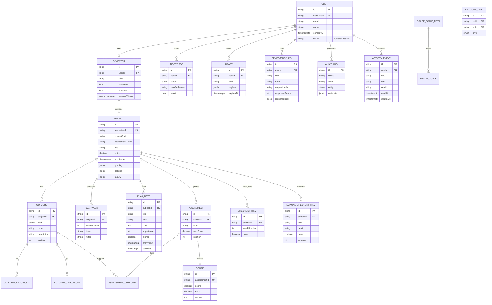

# Target ERD (Neon) — after D4/D5 models land

**Piece:** DB-001 (D0)  
**Note:** Target schema including architecture + product tables. PlanWeek drawn as **Option A** (current); Option B would add `weekFrom`/`weekTo`/`outcomeId`/`activitiesText`.

**pgAdmin (deferred 2026-11-23):** Generate ERD from a **live Neon connection**, not from a `.sql` dump. Connection steps + dump paths → `docs/NEXT-SESSION.md`. Mermaid below remains the in-repo ERD until a pgAdmin export is added.

**Delete rules (owned children):** CASCADE from User / Semester / Subject so account and subject deletion leave no orphans.  
**Blob:** not in ERD — only `IngestJob.blobPathname` references transient Vercel Blob objects.
